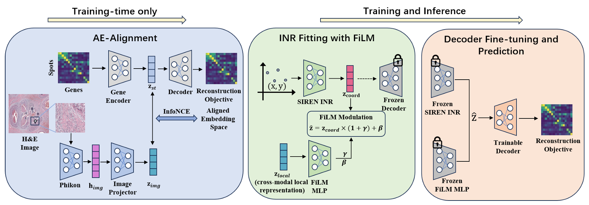

# MorphoINR

Histology-guided continuous spatial transcriptomics imputation via cross-modal aligned latent implicit neural representations.

MorphoINR is a three-stage pipeline instantiated for the `Human_Brain_prefrontal_cortex_151507` spatial-transcriptomics example:

1. an autoencoder aligns a 64-dimensional gene-expression latent representation with 1,024-dimensional Phikon-v2 histology features;
2. a FiLM-conditioned SIREN models the aligned latent representation continuously;
3. the pretrained decoder is fine-tuned on raw expression and used to decode the continuous latent field.



The repository contains the implementation, the fixed human prefrontal cortex example inputs, experiment configurations, preprocessing helpers, and reproducibility instructions. Other datasets are not included.

## Reproduce the complete example

Run all commands from the `MorphoINR/` root.

### 1. Install the environment

```bash
conda env create -f environment.yml
conda activate morphoinr
```

The reference environment uses Python 3.9.25, PyTorch 2.8.0, Lightning 2.6.0, Scanpy 1.10.3, AnnData 0.10.9, and CUDA 12.x. See [environment.yml](environment.yml) and [requirements.txt](requirements.txt).

### 2. Check the included example files

The example files are already present at:

```text
data/random/Human_Brain_prefrontal_cortex_151507/Human_Brain_prefrontal_cortex_151507.h5ad
data/random/Human_Brain_prefrontal_cortex_151507/Human_Brain_prefrontal_cortex_151507_with_phikon.h5ad
data/random/Human_Brain_prefrontal_cortex_151507/Human_Brain_prefrontal_cortex_151507_aealign_with_embeddings_phikon_zlocal.h5ad
data/random/Human_Brain_prefrontal_cortex_151507/tissue_hires_image.png
```

The base file contains 4,226 spots and 3,000 genes with `adata.obsm["spatial"]`, `adata.obsm["spatial_pixel"]`, and a fixed 80/20 train/held-out-evaluation split. The `_with_phikon.h5ad` file additionally contains `adata.obsm["phikon_cls"]`; the `_aealign_with_embeddings_phikon_zlocal.h5ad` file additionally contains `adata.obsm["embeddings"]` and `adata.obsm["z_local"]`. The implementation retains the internal `val` split label for compatibility with these released AnnData files.

See [data/README.md](data/README.md) for provenance and the input contract. These prepared artifacts are included in this repository so that the example does not depend on another local project or directory.

### 3. Run the three-stage experiment

```bash
bash Scripts/train_aligned_film.sh
```

Because the Phikon-enriched input is already included, the script reuses it, trains the aligned AE, writes the stage-1 artifact, and then trains the FiLM-SIREN. The first run still requires the aligned-AE checkpoint to be trained because checkpoints are not included. Run the script from a machine with a CUDA-capable GPU for practical training time; CPU execution is supported but substantially slower.

If you remove the included Phikon-enriched file and want to regenerate it from the base H5AD, pass the image path as the second argument:

```bash
bash Scripts/train_aligned_film.sh \
  Human_Brain_prefrontal_cortex_151507 \
  data/random/Human_Brain_prefrontal_cortex_151507/tissue_hires_image.png
```

Feature extraction downloads `owkin/phikon-v2` through Hugging Face on the first run and therefore requires network access. It is optional when the included `_with_phikon.h5ad` file is available.

### 4. Run stages separately

The fixed configurations are deliberately explicit. Run them in the order shown: the INR stage requires the aligned-AE checkpoint and stage-1 AnnData output produced by the first command.

```bash
python Code/train.py \
  --mode embedder \
  --conf Configs/experiments/Human_Brain_prefrontal_cortex_151507/aealign.yaml

python Code/train.py \
  --mode inr_film \
  --conf Configs/experiments/Human_Brain_prefrontal_cortex_151507/inr_aealign_film_zlocal_siren.yaml
```

The root-level `train.py` is a convenience wrapper around `Code/train.py`. All paths assume commands are launched from the project root.

## Data and generated files

The three H5AD files and the matching histology image for this example are retained in the repository. Check the dataset provider's terms before redistributing the data or publishing a derived mirror. The source and input contract are documented in [data/README.md](data/README.md). Additional datasets are not redistributed.

The pipeline writes:

```text
data/random/Human_Brain_prefrontal_cortex_151507/Human_Brain_prefrontal_cortex_151507_aealign_with_embeddings_phikon_zlocal.h5ad
log/random/Human_Brain_prefrontal_cortex_151507/aealign/
log/random/Human_Brain_prefrontal_cortex_151507/inr_aealign_film_zlocal_siren/
```

Generated logs, checkpoints, decoder weights, and reconstructions are ignored by default. The three supplied H5AD inputs and image are explicitly retained as the reproducibility example.

## Repository layout

```text
MorphoINR/
├── README.md
├── LICENSE
├── CITATION.cff
├── requirements.txt
├── environment.yml
├── train.py
├── Code/
│   ├── datasets.py
│   ├── networks/                    # AE, histology projector, SIREN
│   └── systems/                     # aligned AE and FiLM-SIREN systems
├── Configs/experiments/Human_Brain_prefrontal_cortex_151507/
│   ├── aealign.yaml
│   └── inr_aealign_film_zlocal_siren.yaml
├── Scripts/
│   ├── train_aligned_film.sh
│   ├── preprocess/                  # Phikon extraction and AnnData merging
│   └── diagnostics/
├── data/
│   ├── README.md
│   └── random/Human_Brain_prefrontal_cortex_151507/
├── log/                             # ignored training outputs
├── docs/reproducibility.md
└── Pic/Framework.png
```

## Citation and acknowledgment

If you use this repository, cite the SUICA paper on which the implementation is based and extended, together with the original dataset publication:

> Qingtian Zhu, Yumin Zheng, Yuling Sang, Yifan Zhan, Ziyan Zhu, Jun Ding, and Yinqiang Zheng. “SUICA: Learning Super-high Dimensional Sparse Implicit Neural Representations for Spatial Transcriptomics.” *Proceedings of the 42nd International Conference on Machine Learning*, PMLR 267, 2025. arXiv:2412.01124.

When the MorphoINR manuscript has its final bibliographic record, add that citation here. Dataset terms are defined by their providers and are not replaced by this repository's MIT license.
